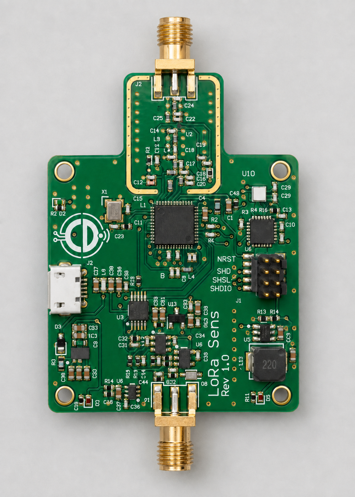
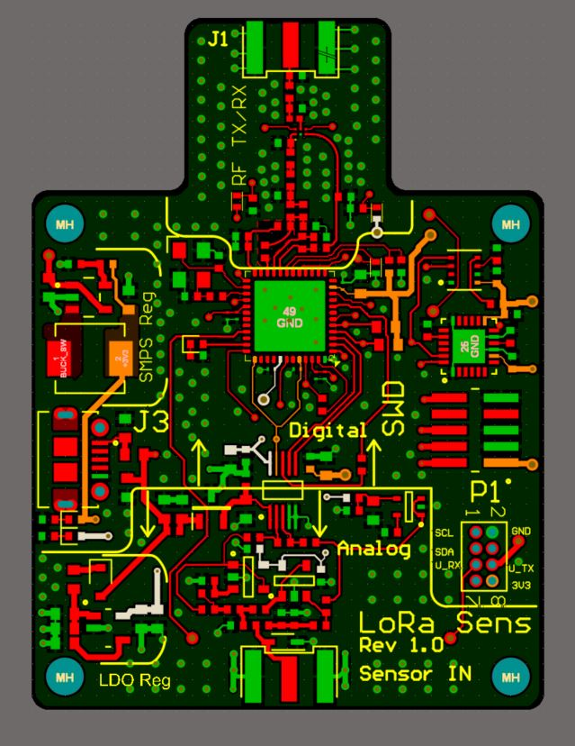
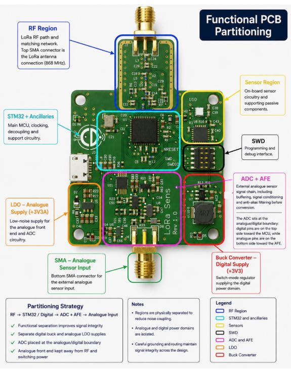

# STM32WL LoRa Sensor Board

**Mixed-signal hardware design | STM32WLE5CC | Sub-GHz RF / LoRa | Analogue acquisition | Four-layer PCB | Altium Designer**

<p align="center">
  
</p>

## Engineering overview

I developed this STM32WL sensor-board design to bring together analogue signal conditioning, precision ADC acquisition, onboard digital sensors, embedded processing, sub-GHz RF and mixed-signal PCB layout within one hardware platform. The project documents the design decisions and verification work behind the **Rev A four-layer PCB**, rather than presenting only a finished layout image.

### Start here — engineering evidence

| Document | What it shows |
| --- | --- |
| **[7-page Hardware Design Summary](Report/STM32WLE5_Hardware_Design_Summary_Rev2.0.pdf)** | A visual overview of the architecture, circuit implementation, PCB partitioning and simulation evidence |
| **[Complete Hardware Design Report — Rev 2.0](Report/STM32WLE5_Hardware_Design_Report_Rev2.0.pdf)** | Detailed treatment of the system, power, sensors, analogue acquisition, RF, layer stack, simulation, DRC and planned verification |
| [Editable report master (Word)](Report/STM32WLE5_Hardware_Design_Report_Rev2.0.docx) | Source document for the full technical report |
| **[Altium project](Hardware/Altium/STM32WL_Sens_ADC_Bat.PrjPcb)** | Editable five-sheet schematic project and Rev A PCB |
| [Complete schematic PDF](Hardware/STM32WL_Schematic.pdf) | Read-only circuit review without Altium |
| [System block diagram](Hardware/STM32WL_BlockDiagram.pdf) | Functional architecture and signal flow |
| [EVT / DVT / PVT project plan](Project_Management/STM32WL_Project_Plan.pdf) | Development stages and planned validation |

**Project status:** Architecture, schematic capture, PCB layout and simulation-based analysis are documented; the PCB has passed the configured Altium DRC with zero reported warnings and violations. **Fabrication, physical bring-up, RF measurements, DVT/PVT and regulatory compliance have not been presented as completed.** Simulation plots are not hardware measurements.

## Hardware architecture

The STM32WLE5CC integrates the MCU and sub-GHz radio. The board also includes a BME280 environmental sensor and MPU-6050 IMU on an I²C bus, plus an independent external analogue sensor input.

The external acquisition chain is designed around:

**SMA sensor input → ESD protection / input filtering → MCP6001 high-impedance buffering → first-order RC and active Sallen-Key low-pass stages → ADC141S626 14-bit ADC → STM32WLE5CC SPI interface**

A REF3033 precision reference supports ADC conversion, while a buffered VCOM bias accommodates the single-supply analogue signal path. The anti-alias filter transition is around 25 kHz; LTspice and Python results are discussed in the full report.

The power architecture separates an efficient **TLV62569 digital buck supply (+3V3)** from the **LD3985 analogue LDO (+3V3A)**. The RF signal chain includes matching and filtering, a BGS12SN6 RF switch and an external SMA antenna interface.

## Four-layer PCB implementation





The PCB layout follows the functional architecture:

- **RF region:** At the antenna end, with short signal paths, local grounding and RF-specific routing rules.
- **Digital region:** STM32WL, onboard sensors and MCU interfaces.
- **ADC boundary:** Acquisition stage positioned between the analogue circuitry and MCU interface.
- **Analogue region:** Sensor input, conditioning, ADC and dedicated analogue power regulation.

Layer 2 provides the primary continuous ground reference, while Layer 3 supports power distribution. The RF path was designed using a 50 Ω controlled-impedance routing profile. The [complete report](Report/STM32WLE5_Hardware_Design_Report_Rev2.0.pdf) includes the layer-stack rationale, implemented rules and DRC evidence.

## Verification and analysis evidence

**[LTspice analogue simulation evidence](Simulation/LTspice)** covers bias generation, the anti-alias filter's frequency and transient behaviour, and associated captured results. This folder contains supporting notes and result images, **not a complete reproducible source set** for every original simulation.

**[LTspice RF simulation material](Simulation/LTSpice_RF_Ouput_Analysis)** documents RF matching and filtering analysis, including an available LTspice circuit file.

**[Python / Jupyter analysis](Simulation/Python_Analysis)** includes FFT, SNR, Sallen-Key and time-domain studies, with [corresponding result plots](Simulation/Python_Analysis/results%20images). These are numerical/simulation investigations rather than measured performance of assembled hardware.

The [Altium DRC evidence](Design_Evidence/STM32WL_DRC_Report.jpg) provides a PCB rule-check checkpoint. A clean DRC establishes compliance with the configured checks; it does not substitute for electrical or RF validation.

## Editable Altium source

The authoritative design is **[STM32WL_RevA.PcbDoc](Hardware/Altium/STM32WL_RevA.PcbDoc)** within the [Altium project](Hardware/Altium/STM32WL_Sens_ADC_Bat.PrjPcb). The project includes five functional schematic sheets, the Rev A PCB, supporting schematic and PCB libraries and the [production output job](Hardware/Altium/STM32WL_Production_RevA.OutJob).

Library sources are supplied under [Hardware/Altium/Libraries](Hardware/Altium/Libraries), alongside the project PCB library. The production output job is configured for the Rev A board; some manually managed output paths refer to the original Windows development directory and may require adjustment when used on another machine.

A remaining L10 footprint-model identity difference was observed during schematic/PCB synchronisation; the physical PCB footprint was retained. This is recorded as a source-library portability consideration, not a claimed hardware validation result.

## Repository guide

```text
STM32WL-LoRa-Sensor-Board-Portfolio/
├── Hardware/
│   ├── Altium/              # PrjPcb, five SchDoc sheets, Rev A PcbDoc,
│   │                        # supporting libraries and production OutJob
│   ├── STM32WL_BlockDiagram.pdf
│   └── STM32WL_Schematic.pdf
├── Report/
│   ├── STM32WLE5_Hardware_Design_Summary_Rev2.0.pdf
│   ├── STM32WLE5_Hardware_Design_Report_Rev2.0.pdf
│   └── STM32WLE5_Hardware_Design_Report_Rev2.0.docx
├── Design_Evidence/         # Partitioning and DRC evidence
├── Images/                  # PCB views and copper-layer illustrations
├── Simulation/
│   ├── LTspice/
│   ├── LTSpice_RF_Ouput_Analysis/
│   └── Python_Analysis/
└── Project_Management/      # EVT / DVT / PVT plan
```

## What this project demonstrates

This repository provides evidence of my approach to hardware development: translating a system concept into partitioned schematics and PCB layout, selecting and integrating RF/analogue/digital components, developing targeted simulation and numerical analysis, applying design rules and recording the verification steps still required before hardware release.

**Tools:** Altium Designer, LTspice, Python, Jupyter and Git/GitHub.
